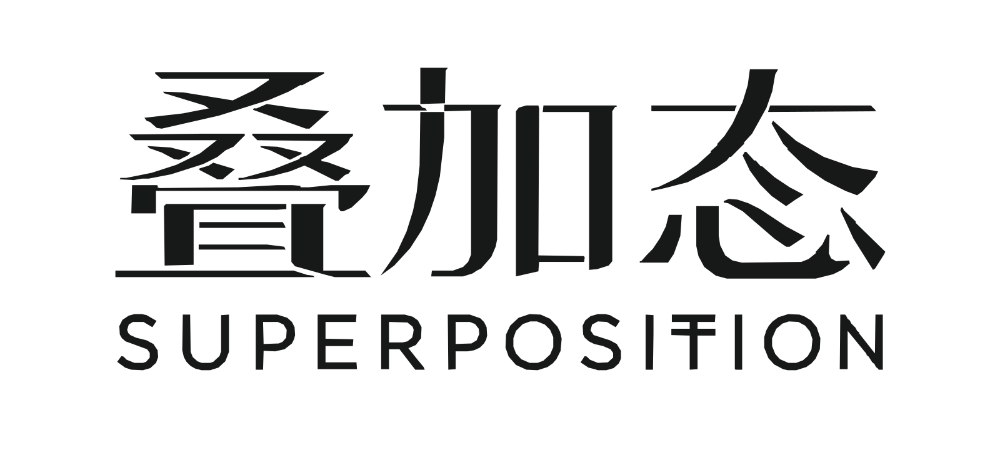
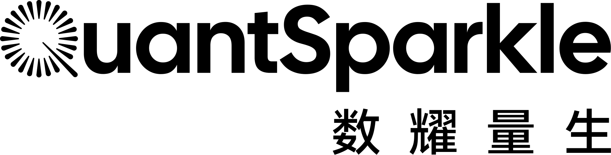

# Shape of the World

[English](./README.md) · [中文](./README.zh.md)

Shape of the World (世界的形状) — see how the world works. A set of playable visual worlds for a general audience: beauty, surprise, and touch come first, and the science follows. Live at [shapeof.world](https://shapeof.world).

This repository holds the web experience, the world runtime and the worlds themselves. The retired private repository `oneworld` is kept only as an archive. The site does not sell anything.

Root [`AGENTS.md`](./AGENTS.md) holds the few facts and rules that apply across the repository.

## Local development

```sh
pnpm install
pnpm dev
```

Open `http://localhost:3000`. Simplified Chinese is the default locale; English pages live under `/en`.

The exact upstream snapshot of the official Three.js periodic-table example and
this project's adaptation live in `vendor/three-periodic-table/`. After changing
it, run `pnpm build:periodic-table`.

## Verification

```sh
pnpm check
```

`pnpm check` is the local quality gate: types, unit and infrastructure tests, the
generators, the production build, the client asset budget and the Worker bundle
budget. The repository does not configure GitHub Actions; the publisher runs this
command on a clean worktree.

For a single world, `pnpm world:check --id <world-id>`.

## Deploy

Production is Cloudflare Workers: Worker `shape-of-the-world` serves
`shapeof.world`. The site as it stood before 2026-10-21 stays online, unindexed,
at `v2.shapeof.world`. Analytics (`infra/insights`) and the video press kits
(`infra/press`) deploy as their own Workers.

```sh
pnpm check
pnpm build
npx wrangler deploy
```

## Product architecture

- TanStack Start + TanStack Router: server rendering and routing
- Client experience registry: each world’s component, private CSS and English dictionary lazy-load in parallel; large browser engines stay out of the Worker server bundle
- 384×256 catalogue thumbnails: catalogue and series cards never download a 2560px poster
- deck.gl / Flowmap.gl, model-viewer, Mol* and Three.js adapters: flow networks, structure, molecules, planetary imagery and native interactive experiments
- Cloudflare Workers: edge deploy, same-origin assets and anonymous events
- Build budgets: Worker, global CSS, shared experience runtime, individual JS chunks and Cloudflare static asset size
- An installable PWA shell
- Anonymous product events: opens, real interaction, meaningful dwell, saves, shares and remote-asset load failures; no knowledge content and no personal identity

## Worlds and their sources

Every world carries its own source and rights record beside its code, and the
project only ships material that is either drawn by the project or licensed by a
third party for reuse with attribution, without a permission request and without
a non-commercial restriction. The entry rule for new worlds is in
[AGENTS.md](./AGENTS.md).

- Third-party code and assets: [OSS_NOTICES.md](./OSS_NOTICES.md)
- Data sources and evidence: [DATA_SOURCES.md](./DATA_SOURCES.md)
- Product scope and vocabulary: [CONTEXT.md](./CONTEXT.md)

## Licensing and commercial terms

- Project-owned software in this repository: [`AGPL-3.0-only`](./LICENSE).
  Commercial use that fully meets the AGPL obligations for that use needs no paid
  licence. Using the code in a closed-source product or service beyond the AGPL
  grant requires a separate [commercial licence](./COMMERCIAL_LICENSE.md).
- Original editorial copy and project-owned visual work: [`CC BY-NC 4.0`](./CONTENT_LICENSE.md).
  Uses outside that NonCommercial grant that legally need a copyright licence
  require separate written permission.
- Third-party code, models, data, images, fonts, audio and embedded services keep
  their own licences; this repository’s terms do not relicense them.
- The name “Shape of the World / 世界的形状”, the logo and brand marks are not
  licensed with the code or content: [TRADEMARKS.md](./TRADEMARKS.md).

Full boundaries: [LICENSING.md](./LICENSING.md). Contribution rules:
[CONTRIBUTING.md](./CONTRIBUTING.md), with [CLA.md](./CLA.md) and
[CCLA.md](./CCLA.md) for copyrightable contributions.

## Contributors

- [MakerJackie](https://github.com/makerjackie): creator and maintainer.
- Past contributor: Yu ([yuzerofish](https://github.com/yuzerofish)), design and development, July to October 2026.

## Sponsors

This project is sponsored by 叠加态社区 (SUPERPOSITION) and 数耀量生 (QuantSparkle).

<table>
  <tr>
    <td align="center" valign="middle">
      <picture>
        <source media="(prefers-color-scheme: dark)" srcset="./public/assets/sponsors/superposition-white.svg">
        
      </picture>
    </td>
    <td align="center" valign="middle">
      <picture>
        <source media="(prefers-color-scheme: dark)" srcset="./public/assets/sponsors/quantsparkle-white.png">
        
      </picture>
    </td>
  </tr>
</table>

Rights for sponsor logos: [asset notice](./public/assets/sponsors/NOTICE.md).
