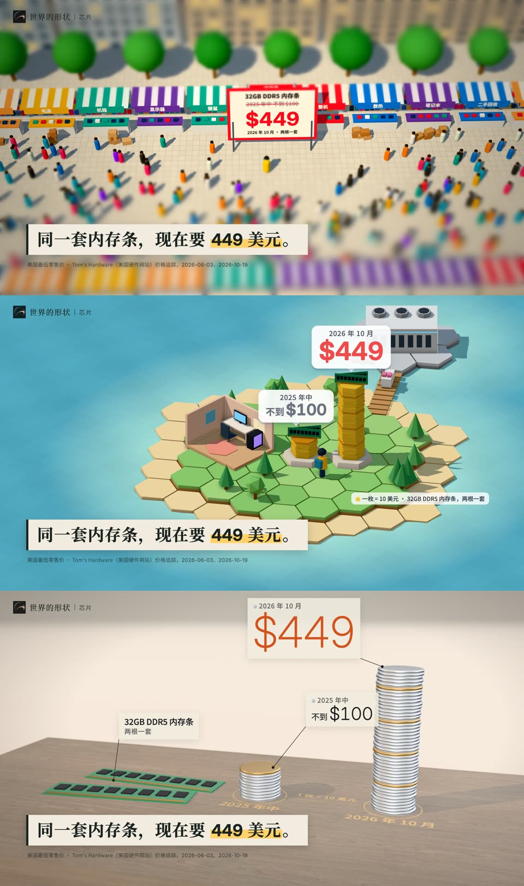

# 品牌骨架、画风和声音

做片的规矩只看 [`../DIRECTOR.md`](../DIRECTOR.md)。这里放它引用的具体值、画风的选型记录、声音清单，以及《AI 到底改变了什么》的开头样片。

## 一、品牌骨架：每部片都一样

画风按题目换，下面这些不换。

| 部件 | 规定 |
|---|---|
| 角标 | 左上，距左 48 px、距顶 38 px：圆形的球（`public/assets/brand/kit/mark-disc.png`，46 px，绝不用方块的 `mark-*.png`）+"世界的形状"（Noto Serif SC SemiBold 28 px，字距 0.08 em），可加一道竖线和章节词（Noto Sans SC 22 px）。整体 80% 不透明；浅色画面用墨色，深色画面用纸白 |
| 叙述字幕 | 纸色 `#f1ecdf` 纸条，墨色 `#19231f` Noto Serif SC Bold 60 px，左边 8 px 墨色竖边，轻投影；固定在左下（距左 96 px、距底 148 px）。纸条从左划出 0.25 s，字逐个打出（中文每秒 14 字，英文每秒 30 个字母），第一个字落在拍上 |
| 关键词 | 品牌金 `#ffd166` 荧光笔，压在字的下半部，打完后的下一拍刷上（0.3 s） |
| 数字 | Inter，等宽数字；字重随画风（实物读数用 250–300） |
| 来源小字 | Noto Sans SC 19 px，60% 不透明，纸条下方；完整来源进简介 |
| 颜色 | 纸 `#f1ecdf`、墨 `#19231f`、品牌金 `#ffd166`（只给关键词和"那一个发现"）；涨跌用语义红绿；读数的强调用信号橙 `#d4521c` |
| 声音 | 四个品牌音效，见下文第四节；音频标志可选 |
| 片尾卡 | 正中"世界的形状"（带球的组合标志），底部一行 MakerJackie，约 3 秒 |
| 不再有 | 频谱条、进度条、来源页、制作页、"说句公道话"标签、开场定格的结论句 |

为什么是纸条：在亮的和暗的画面上都读得清，手机上一眼能认出来；和封面顶部的纸色品牌条是同一个东西。知识区常见的是黑体白字描边，纸条加衬线字更像"有人在讲故事"。

## 二、画风：选型记录

三张风格帧画的是同一个时刻（一套 32GB DDR5 内存条的价格）：



| 帧 | 方向 | 用户的判断 |
|---|---|---|
| [`frames/a-tiltshift.jpg`](frames/a-tiltshift.jpg) | 移轴微缩 | 这个题目第一眼读不出来 |
| [`frames/b-lowpoly.jpg`](frames/b-lowpoly.jpg) | 低多边形小世界 | 第一眼读不出来；但讲人和工作时更好玩 |
| [`frames/c-physical.jpg`](frames/c-physical.jpg) | 数据实物化 | **最好**：真的内存条、一摞摞硬币，第一眼就是"哇，真贵了" |

随后按 C 为主、B 为辅的混合做了 16 秒动态样片（第三节），**被用户否了**（"好糟糕"，比旧的图表片还差），问题记在 `../DIRECTOR.md` 参考第五节。方向正在和用户重新讨论。当时的混合方案是：

- **主画面**：暖色、明亮的影棚桌面，胡桃木台面，真实大小的物件，价格变成硬币堆（一枚一个单位，每第 10 枚是黄铜色的刻度）。
- **讲人和工作时**：同一张桌面上出现低多边形的小镇和小人（平涂、六角地块、几何体），真物件是真实大小，小镇是模型大小，始终是同一个世界。
- **背景**暖而浅；黑暗只当戏剧手段（安静、夜里、坏消息）。
- 字和数字放在语言层（`zh.json`、`en.json`），中文版用人民币，英文版用同一套画面换成美元。

## 三、《AI 到底改变了什么》的开头样片

[`samples/ai-impact-opening/`](samples/ai-impact-opening/)：开头 16 秒，"价签暴涨"，混合画风，带音乐和音效。**2026-10-23 被用户否了**：three.js 的简单几何像占位符，打字的约 6 秒镜头几乎不动，字幕小、在左下角像幻灯片，前 2 秒没抓住人，左上角用了方块标志（代码已改成圆形的 `mark-disc.png`，没有重渲）。下面的表留作记录。总览图（每 0.5 秒一帧）：[`samples/ai-impact-opening/contact-zh.jpg`](samples/ai-impact-opening/contact-zh.jpg)。

| 片中 | 拍 | 画面 | 字 | 声音 |
|---|---|---|---|---|
| 0.03 s | 第 0 小节强拍 | 桌上一套内存条、9 枚硬币（¥900）、一个 3 厘米高的小人；第 9 枚落下 | 读数"2025 年 ¥900" | 硬币声，音乐只有轻轻的拍点 |
| 0.53–2.03 s | 第 2 拍起 | 硬币越落越密，镜头跟着往上升，读数按落下的硬币跳 | ¥1,000 → ¥3,700 | 每枚一声，第 10、20、30 枚各响一个马林巴音（A、C、E） |
| 2.03 s | 第 1 小节强拍 | 第 38 枚落定，读数翻成橙色"2026 年 7 月 ¥3,800"，小人往后一跳 | | 低沉撞击 + 陶瓷轻敲；音乐整段进来 |
| 2.53 s | 拍 | 去年的高度留下一圈黄铜环和"去年 ¥900" | | 轻点 |
| 3.03 s | 拍 | 镜头绕着硬币塔慢慢转 | 去年 900 元的内存条， | 纸条、轻点 |
| 6.03 s | 第 3 小节强拍 | | 现在要 3800 元。（7.03 s 刷金） | 轻点 |
| 8.03 s | 第 4 小节强拍 | 镜头沿桌面拉远、右移，露出桌子另一头的低多边形小镇 | | 丝带掠过 |
| 8.53–10.03 s | 每拍 | 数据中心一层一层落下来，屋顶最后落 | 10.03 s：内存条为什么突然这么贵？ | 木块敲击，一层一个音 |
| 12.03–13.03 s | 每拍 | 运内存的小卡车开进数据中心，窗户一层层亮起 | 12.03 s：AI 的数据中心，在抢内存。 | 开关声；机房的嗡声提前半小节进来 |
| 14.03 s | 第 7 小节强拍 | 屋顶风扇亮起转快 | "在抢内存"刷金 | 低沉撞击 |

数字：

- 价格用央视财经 2026 年 7 月在深圳华强北的调查："32G DDR5 内存去年 900 元，现在 3800 元"，"一套 32GB 的 DDR5 内存套装目前已经涨到近 4000 元，比去年贵了三四倍"（经同花顺、财联社转载，<https://news.10jqka.com.cn/20260707/c677990782.shtml>）。一个来源同时给了两头的价，倍数（约 4.2 倍）和美国零售价的涨幅（不到 100 美元 → 449 美元）一致。
- 佐证：京东上光威龙武-弈 DDR5-6000 32GB（16GB×2）2025-06-15 活动价 499 元（中关村在线、快科技同日）；同规格 2026-02 京东现售 3359 元（中关村在线）；2026-09 国内同类 32GB DDR5-6000 套条"普遍报价在 3800 元左右"（中关村在线）。这一组型号和口径不完全一致，只放简介里作参考。
- 汇率备用：2026-10-22 美元兑人民币中间价 6.7195（中国外汇交易中心）。
- "AI 的数据中心，在抢内存"依据 `../ai-impact/research/03-memory-chips.md`：AI 服务器要的高带宽内存和服务器内存挤占了消费级内存的产能（TrendForce）。

## 四、声音

试听：每个 id 在 `https://music.shapeof.world/track/<id>` 有页面。`python films/brand/sound/make_sound.py` 在 `films/brand/sound/out/` 生成音频标志草稿和音效试听文件（WAV 不进 Git）。

**音频标志**（可选，每部片自己定）：一口气 → A4、E5、C#6 三个木琴音从左到右（像三笔画出一个圈）→ 第三个音上"球"落地（110 Hz，带二、三次谐波，手机外放也听得到）→ 玻璃余光，共 2.6 秒。

**音效调色板**

| 时刻 | id | 名字 | 层 |
|---|---|---|---|
| 一行字开始打出 | [`sfx-ui-01`](https://music.shapeof.world/track/sfx-ui-01) | 轻点 | 品牌 |
| 纸条字幕划入 | [`sfx-foley-02`](https://music.shapeof.world/track/sfx-foley-02) | 卡片滑动 | 品牌 |
| 数字落定 | [`sfx-impact-06`](https://music.shapeof.world/track/sfx-impact-06) | 陶瓷轻敲 | 品牌 |
| "那一个发现"亮起 | [`sfx-impact-05`](https://music.shapeof.world/track/sfx-impact-05) | 玻璃轻碰 | 品牌 |
| 硬币、金属小件落下 | [`sfx-impact-03`](https://music.shapeof.world/track/sfx-impact-03) | 金属轻敲 | 世界（按材质换） |
| 物件落地、小镇的楼块 | [`sfx-impact-01`](https://music.shapeof.world/track/sfx-impact-01) | 木块敲击 | 世界 |
| 计数、开关 | [`sfx-mechanical-13`](https://music.shapeof.world/track/sfx-mechanical-13) | 进纸机构 | 世界 |
| 镜头内转场 | [`sfx-transition-02`](https://music.shapeof.world/track/sfx-transition-02) | 丝带掠过 | 世界 |
| 安静之后的重拍 | [`sfx-impact-08`](https://music.shapeof.world/track/sfx-impact-08) | 低沉撞击 | 世界 |

挑法：240 个音效全部下载，量了时长、起音、衰减、音高稳不稳、低频占比，再看频谱；有颤音、像"弹簧"的都排除。目录里的文字描述（`audioReview`）和实际声音常对不上。

环境声（CC0，可无缝循环）：影棚底噪 [`ambience-room-01`](https://music.shapeof.world/track/ambience-room-01)（安静通风）；数据中心 [`ambience-machine-02`](https://music.shapeof.world/track/ambience-machine-02)（服务器机房）。

**配乐**（只用已确认可商用的曲子）

- 开头和前半段：[《有序运动 · 40》`scene-minimalism-40`](https://music.shapeof.world/track/scene-minimalism-40)。实测 120 BPM，A 小调；母带前 4 秒只有每拍一下的轻响，4.03 s 整段进来，之后每 4 小节换一次句。样片从曲子 2.0 s 处开始放，让整段进来正好落在价签翻牌上。
- 全片的其余部分在全片阶段定，同样先从已确认可商用的曲子里挑；备选是 [`scene-game-minimalism-exploration`](https://music.shapeof.world/track/scene-game-minimalism-exploration)（低音马林巴，可无缝循环）和 [`scene-minimalism-90`](https://music.shapeof.world/track/scene-minimalism-90)。
- Gate 1 时列过的《形状咬合》《擒纵》《世界的形状 · 木琴》都标着"使用权限待核对"，不再用。

## 五、怎么重做

都在 Mac 上跑。字体不进 Git，先下到 `films/brand/fonts/`：

```bash
mkdir -p films/brand/fonts && cd films/brand/fonts
curl -L -o NotoSansSC.ttf  "https://github.com/google/fonts/raw/main/ofl/notosanssc/NotoSansSC%5Bwght%5D.ttf"
curl -L -o NotoSerifSC.ttf "https://github.com/google/fonts/raw/main/ofl/notoserifsc/NotoSerifSC%5Bwght%5D.ttf"
curl -L -o Inter.ttf       "https://github.com/google/fonts/raw/main/ofl/inter/Inter%5Bopsz%2Cwght%5D.ttf"
cd -
node films/brand/frames/src/shoot.mjs                                  # 三张风格帧
node films/brand/samples/ai-impact-opening/render.mjs video --lang zh   # 画面 → out/video-zh.mp4、out/events-zh.json
python films/brand/samples/ai-impact-opening/mix.py zh                  # 声音和成片 → out/sample-zh.mp4（约 −12 LUFS）
node films/brand/samples/ai-impact-opening/render.mjs stills 2.6 9 --lang en   # 英文版的单帧
```

在 worktree 里运行时，用 `NODE_MODULES=<主仓库>/node_modules` 指向装好 three 和 playwright 的那份；Python 用装了 numpy、scipy 的环境。样片 486 帧在 Mac mini 上约 20 秒渲完。

- `frames/src/common.js`、`skeleton.css`：品牌骨架层和共用工具。
- `frames/src/*.html`：三张风格帧的场景。
- `samples/ai-impact-opening/index.html`：样片，`window.render(t)` 逐帧画，`window.EV` 给出每个音效的时间；拍点网格、镜头关键帧都在文件开头。`zh.json`、`en.json` 是语言层。
- `sound/make_sound.py`：音频标志和音效试听。

## 素材和授权

- 胡桃木贴图：Poly Haven 的 american_walnut_veneer，CC0，从 lemo-opuscar 的 `core/assets/polyhaven/` 复制并缩到 1024 px。
- 字体：Noto Sans SC、Noto Serif SC、Inter，SIL OFL 1.1。three.js：MIT。
- 画风参考 [lemo-opuscar](https://github.com/lemomo-ai/lemo-opuscar) 的 `styles/data-physical`、`lowpoly-island`、`tilt-shift`（MIT / CC BY 4.0），代码是自己写的。
- 音乐、音效和环境声来自自己的曲库：音乐用 `rights.commercialUse = true` 的，音效和环境声是 CC0。
